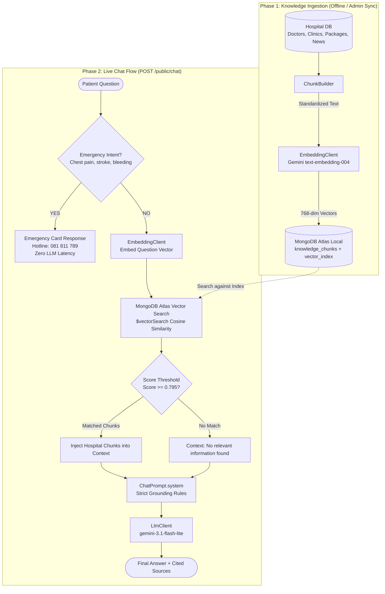

# Orienda Hospital: AI RAG Chat Architecture Flow

This document explains how the Retrieval-Augmented Generation (RAG) system powers the hospital's AI assistant (`POST /public/chat`).

---

## 1. High-Level Architecture Diagram

---

## 2. Step-by-Step Flow

### Phase 1: Knowledge Ingestion (Data Preparation)
1. **Source Extraction**: Reads active records from MongoDB (`packages`, `doctors`, `clinics`, `branches`, `news`, `health_tips`).
2. **Chunk Building** ([`chunk_builder.dart`](file:///lib/helper/chunk_builder.dart)): Formats raw database models into standalone text paragraphs containing titles, prices, branches, and doctor qualifications.
3. **Vector Embedding**: Sends chunks to Google Gemini `text-embedding-004` to generate mathematical vectors (768 numbers).
4. **Storage**: Saves vectors to `db.knowledge_chunks` with an active Atlas Vector Index (`vector_index`).

---

### Phase 2: Live Chat Query (`POST /public/chat`)

| Step | Action | Why We Do It |
| :--- | :--- | :--- |
| **1. Emergency Guardrail** | Regex check for life-threatening keywords (*heart attack, can't breathe, heavy bleeding*). | **Safety First**: Immediately returns emergency hotline numbers without waiting for AI. |
| **2. Query Embedding** | Converts user question into a 768-dimension vector. | Allows mathematical semantic search rather than plain keyword matching. |
| **3. Atlas Vector Search** | Runs `$vectorSearch` with cosine similarity in local MongoDB Atlas. | Finds the top 4 most relevant hospital knowledge chunks. |
| **4. Threshold Cutoff** | Keeps only chunks with similarity `score >= 0.795`. | **Relevance Filter**: Filters out irrelevant hits (e.g., car repairs vs. medical care). |
| **5. Strict Prompting** | Assembles [`ChatPrompt.system`](file:///lib/services/chat_prompt.dart) with retrieved knowledge. | **Anti-Hallucination**: Enforces Rule 1: *"Answer ONLY from the CONTEXT below. If not there, say you do not have that information."* |
| **6. LLM Generation** | Calls Gemini with prompt and recent chat history. | Generates a polite, natural response strictly bounded by hospital facts. |
| **7. Response Return** | Returns JSON with answer, emergency flag, and source links. | The mobile app displays the answer and clickable reference cards. |

---

## 3. Why This Architecture Works

- **No Hallucinations**: The model cannot make up fake doctor names or non-existent discounts because it is restricted to retrieved context.
- **Off-Topic Protection**: Queries like *"What is C++?"* match 0 hospital chunks and trigger a polite refusal instead of answering programming questions.
- **Privacy & Speed**: Public queries are stateless (0 database writes), keeping patient conversations private and lightweight.
